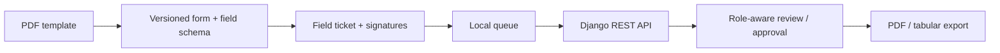

# PDF Editor / field-form workflow

A TypeScript/React workspace for placing structured fields on PDF templates,
publishing form versions, completing field tickets and reviewing signed results.
The Django REST API supplies authentication, permissions, form/ticket persistence
and file endpoints. Internal packages use the RelayForms name; existing visual
branding is unchanged.

## Review the product without a service

Node 22:

```bash
npm ci --prefix v3
VITE_DEMO_MODE=true npm run dev --prefix v3
```

Open Vite's local URL. **This is an explicit local simulation.** Its sample records,
role switcher and queue completion are browser-only. A visible demo label remains
in the application; simulated sync does not mean a server received the ticket.
No API base URL may be configured at the same time as demo mode.

Try the existing workflow: inspect a form in Builder, open a field ticket, enter
values/signatures, queue the submission, then inspect it in Review. Use synthetic
PDFs and data. Demo records and PDF cache have separate browser storage namespaces
from connected mode. Older builds mixed demo and API state under `rf_store_v1` / `rf_offline_cache`.
Those stores remain untouched and are never automatically loaded into the new API
queue. **Before upgrading an existing installation, inspect/export any unsent work
from the old build.** Server records remain authoritative; this review branch does
not migrate ambiguous local drafts. Fresh local reviewers need no migration.

## Architecture and evidence



| Area | Implementation to inspect |
| --- | --- |
| PDF rendering, cached files, export | [PDF features](v3/src/features/pdf/) · [exporters](v3/src/features/export/exporters.ts) |
| Field schema, access and signature roles | [shared libraries](v3/src/shared/lib/) and their tests |
| Offline submission queue | [queue processor](v3/src/features/offline-queue/useQueueProcessor.ts) |
| Authentication and durable records | [models](backend/core/models.py) · [views](backend/core/views.py) |
| Server permission boundary | [permissions](backend/core/permissions.py) · [tests](backend/core/tests/) |
| Explicit simulation/API configuration | [mode contract](v3/src/shared/api/mode.ts) |

Admin and worker capabilities are enforced by the API in connected mode. A local
role switch is a demonstration affordance, not authentication. The queue retries
pending work when online; this repository does not claim exactly-once delivery or
that a client connection failure proves a submission was rejected.

## Connected local setup

Python 3.12, a fresh virtual environment, and your own local accounts:

```bash
python3.12 -m venv .venv
. .venv/bin/activate
python -m pip install -r backend/requirements.txt
export DJANGO_DEBUG=true
export DATA_DIR="$(mktemp -d /tmp/pdf-workflow-local.XXXXXX)"
export DJANGO_ALLOWED_HOSTS=127.0.0.1,localhost
export CORS_ALLOWED_ORIGINS=http://localhost:5173
python backend/manage.py migrate
```

Set your own local `ADMIN_EMAIL`/`ADMIN_PASSWORD` and optionally
`WORKER_EMAIL`/`WORKER_PASSWORD` in the environment, then run
`python backend/manage.py seed_initial`. No shared password is distributed.
Start `python backend/manage.py runserver 127.0.0.1:8000`, and in another terminal:

```bash
VITE_DEMO_MODE=false VITE_API_BASE_URL=http://127.0.0.1:8000/api npm run dev --prefix v3
```

Values prefixed `VITE_` are public build configuration. Never put credentials in
them. Missing/contradictory mode configuration shows a setup notice instead of
silently opening a simulated authenticated workspace.

## Reproducible checks

```bash
python scripts/test_backend.py
python scripts/test_backend.py makemigrations --check --dry-run
VITE_DEMO_MODE=true npm run test:run --prefix v3
VITE_DEMO_MODE=true npm run build --prefix v3
```

The backend runner uses temporary media and in-memory SQLite and forbids network
connections. Existing backend tests cover models, serializers, permissions, views,
management commands and migrations; added configuration tests require a real secret
when DEBUG is off. Frontend tests cover access, signatures, filtering, identifiers,
rounding and mode selection. [CI](.github/workflows/ci.yml) installs the checked-in
npm lockfile and runs these checks. It never deploys.

## Operational limits

With `DJANGO_DEBUG=false`, startup requires an explicit `DJANGO_SECRET_KEY` of at
least 50 characters; the historical insecure fallback is rejected. Configure
hosts, origins, database/media persistence and the trusted proxy for the actual
host before deployment. The test profile is never a runtime profile.

Migration `0004` records five indexes already declared in the models; it preserves
existing rows. Existing client branding, imagery and any publication claims still
require owner approval. No client relationship or licence grant is asserted here.
See [review limits](docs/REVIEW_LIMITS.md) for outstanding dependency/operational work.
